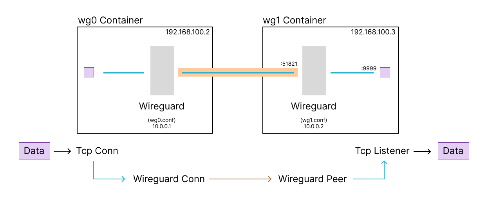
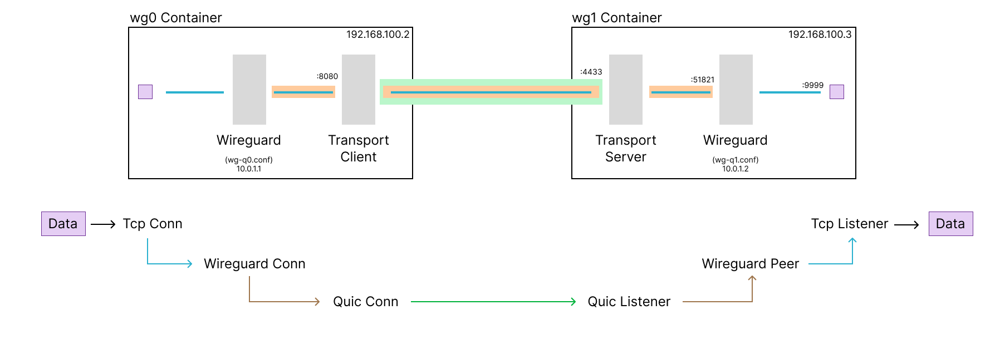

This env sets up two containers that can communicate with each other using a wireguard connection.

This is intended to help test wireguard over a transport. 


stand up the environment

```sh
docker compose up --build
```

This will build and start the containers. 


connect to the `wg0` container -- a similar command can be used to connect to the `wg1` container

```sh
docker exec -it wg0  bash
bash@1234567890$ 

```


Within the container we can ping, try connections, capture packets etc.

```sh
# capture packets on the containers main interface
tcpdump -i eth0 -n -v


# capture packets on the wireguard interface within the container
tcpdump -i wg0 -n -v
```


---

## TCP listen and connect over wireguard



```sh
# wg0

# listen on tcp port 9999
nc -lv -p 9999
```


```sh
# wg1

# connect over wireguard to the tcp listener
nc 10.0.0.1 9999
```

---

## TCP over Wireguard over Quic



```sh
# in wg1 container -- listen on tcp:9999 for incoming test connection
nc -lv -p 9999


# in wg1 container -- run the server side of the connection forwarder
#
# this uses the default configuration file for the docker env in 
# `test-env/test-config/server.toml` mapped in to `/etc/nym/transport/server.toml`
nym-bridge -c /etc/nym/default-nym-node/server.toml

# in wg0 container -- run the client capable of connecting to the server
#
# alternatively the forwarding client using TLS can be run using the following.
# note, based on config this binds the same port as the quic config so one of them
# must be modified if they are to be run at the same time.
client-udp --config /etc/nym/default-nym-node/client_quic.toml
client-udp --config /etc/nym/default-nym-node/client_tls.toml
client-udp --config /etc/nym/default-nym-node/client_ssh.toml

# in wg0 container -- open a tcp connection to kick off the layered wrapped tunnel to the netcat tcp listener on the server
nc -vvv 10.0.1.2 9999
```

---

## AmneziaWG translator lab

`./test-env/awg-lab.sh` builds the env, starts `nym-bridge` in `wg1` (QUIC, TLS, SSH, an AmneziaWG 1.0
port on 51830 and an AmneziaWG 3.1 port on 51831, see `test-config/server.toml`) and runs, with a
censor in `wg0` that drops vanilla WireGuard handshake initiations:

0. the amneziawg-go builds under test (default: the version nym-vpn-client ships, plus v0.2.13)
1. fallbacks: vanilla WireGuard and base mode to the plain port, old and new clients through the
   translators, censor blocking vanilla and base mode
2. header, padding and decryption format on the wire (1.0 and 3.1 header protection)
3. datagram collisions: transport packets at padded handshake sizes
4. MTU: DF pings at the tunnel MTU, no IP fragments
5. benchmarks: iperf3 and RTT per path
6. QUIC, TLS and SSH bridges through the censor, translator speed gated against the QUIC bridge
7. SNI and hostnames visible on the wire

About 4 minutes once the image is built (first build about 10 minutes). Override versions with
`AWG_VERSION=... AWG_LEGACY_VERSION=... ./test-env/awg-lab.sh`.
